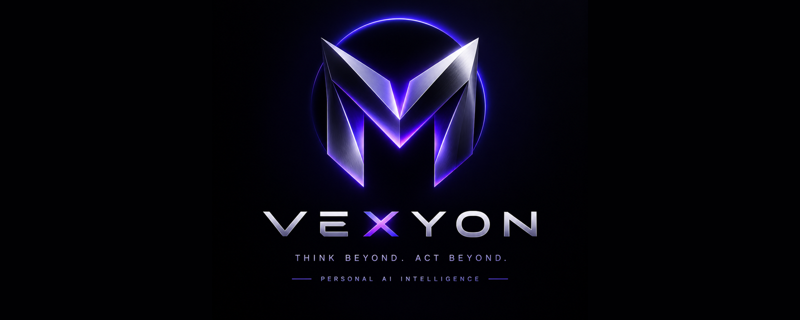

<div align="center">



# VEXYON

**Personal AI Intelligence — private, local, offline.**
A Windows desktop assistant that runs AI models on *your* machine, reads *your* files, and keeps *your* data with you.

[](../../actions/workflows/build.yml)


**English** · [العربية](README.ar.md)

</div>

---

## Overview

VEXYON is a local-first AI workspace for Windows. It talks to open models through [Ollama](https://ollama.com), indexes the documents you choose, and answers questions about them — in Arabic or English — without sending your files to any server.

Beyond chat, the assistant can use tools: read and search files, work with Excel sheets, run Python for exact calculations (with your approval), find installed programs, and remember preferences you give it.

## Features

| | |
|---|---|
| 🔒 **Offline & private** | Index, chats, settings and memory live in `%AppData%\VEXYON`. Nothing is uploaded. |
| 💬 **Arabic-first chat** | Full right-to-left interface and Arabic conversations, with a *deep thinking* mode for harder questions. |
| 📚 **Personal library** | Watches a folder (default `Documents\MyBrain`) and indexes PDF, Word, Excel and text files into a local SQLite database. |
| 🧰 **Tool use** | `read_file`, `search_files`, `list_files`, `folder_overview`, `read_excel`, `create_file`, `edit_file`, `run_python`, `run_command`, `find_program` and more. |
| 🧮 **Verified calculations** | Built-in math and structural-engineering libraries (`vexyon_math`, `vexyon_calc`) with a 22-test self-check and answer verification by substitution. |
| 🧠 **Long-term memory & lessons** | Persistent instructions, editable memory, and short “lessons” learned from corrected mistakes. |
| 🌐 **Optional web search** | Off by default. When enabled, queries go to DuckDuckGo; every action is written to `audit.log`. |
| 📊 **Live performance bar** | CPU, RAM, GPU and CPU temperature, refreshed every ~1.5 s, with colour warnings. |
| 🛠 **Tools hub** | Detects installed programs system-wide and offers one-click downloads (Python, VS Code, Tesseract, LibreOffice, Pandoc, 7-Zip, FFmpeg …). |
| 💾 **Backup & restore** | Back up and restore your whole VEXYON data folder. |
| 🎨 **Dark / light themes** | Polished purple-blue theme in both modes. |
| 🛡 **Safe by default** | Commands and code run only after your approval; a blocklist stops dangerous operations. |

## Screenshots

<table>
  <tr>
    <td><br/><sub><b>Start here</b> — guided first-run setup</sub></td>
    <td><br/><sub><b>Chat</b> — ask in Arabic or English</sub></td>
  </tr>
  <tr>
    <td><br/><sub><b>Library</b> — your indexed files</sub></td>
    <td><br/><sub><b>Tools</b> — detected & recommended programs</sub></td>
  </tr>
  <tr>
    <td><br/><sub><b>Settings</b> — models, memory, safety</sub></td>
    <td><br/><sub><b>About</b> — version, system specs, EULA</sub></td>
  </tr>
</table>

> Screenshots are captured automatically from the real app by the CI workflow after the first successful build (see [docs/README.md](docs/README.md)).

## Download

Get the latest **`VEXYON-v*-win-x64.zip`** from the [Releases](../../releases) page (or from the *Artifacts* of any [Actions](../../actions) run). The zip contains:

```
VEXYON-v1.1.0-win-x64/
├── VEXYON.exe              ← ready to run, no .NET install needed
├── README.md / README.ar.md
├── EULA.txt
├── THIRD_PARTY_NOTICES.txt
├── docs/                   ← logo, banner, screenshots, notes
└── source/                 ← full project files
```

Windows SmartScreen may warn about an unsigned executable until the app is code-signed (see below).

## Requirements

- Windows 10 / 11 (x64)
- 8 GB RAM or more recommended
- About 5 GB of disk space for the AI models
- [Ollama](https://ollama.com) (one-click download inside the app)
- Internet **once**, to download the models — after that VEXYON works fully offline
- Python 3 (optional, for the calculation tools)

## Quick start

1. Run `VEXYON.exe` — the **Start here** tab walks you through the steps.
2. Install Ollama (button inside the app).
3. Press **Download models** (default chat model: `qwen3:4b`, embeddings: `bge-m3`).
4. Drop your files into `Documents\MyBrain`.
5. Open **Chat** and start asking.

## Build from source

Requires the [.NET 8 SDK](https://dotnet.microsoft.com/download/dotnet/8.0).

```bat
:: quick build + run
Build.bat

:: self-contained single-file exe (+ installer if Inno Setup 6 is installed)
BuildRelease.bat
```

or manually:

```powershell
dotnet publish VEXYON.csproj -c Release -r win-x64 --self-contained true `
  -p:PublishSingleFile=true -p:IncludeNativeLibrariesForSelfExtract=true -o publish
```

You can also open `VEXYON.csproj` in Visual Studio 2022+ and press **F5**.

### Continuous integration

`.github/workflows/build.yml` builds on every push / pull request and produces the zip above as a downloadable artifact. Pushing a tag such as `v1.1.0` also publishes it as a GitHub Release:

```bash
git tag v1.1.0 && git push origin v1.1.0
```

## Tech stack

WPF · .NET 8 · SQLite (`Microsoft.Data.Sqlite`) · PdfPig · Open XML SDK · Ollama · Python helpers

## Data & privacy

All data stays in `%AppData%\VEXYON` (`brain.db` index, `audit.log` command log, `memory.txt`, `lessons.txt`, `tools.json`, `lib\`). The only network features are the optional web search and the model downloads you start yourself.

## Disclaimer

AI output can be wrong. Engineering calculations are an aid only and do **not** replace review by a licensed engineer. See the [EULA](EULA.txt).

## License

© 2026 Eng. Moustafa Khalaf. All rights reserved — see [EULA.txt](EULA.txt). Third-party components are listed in [THIRD_PARTY_NOTICES.txt](THIRD_PARTY_NOTICES.txt).

## Contact

Eng. Moustafa Khalaf — mostafakhalaf861@gmail.com
